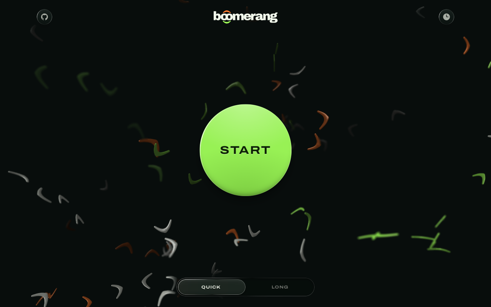
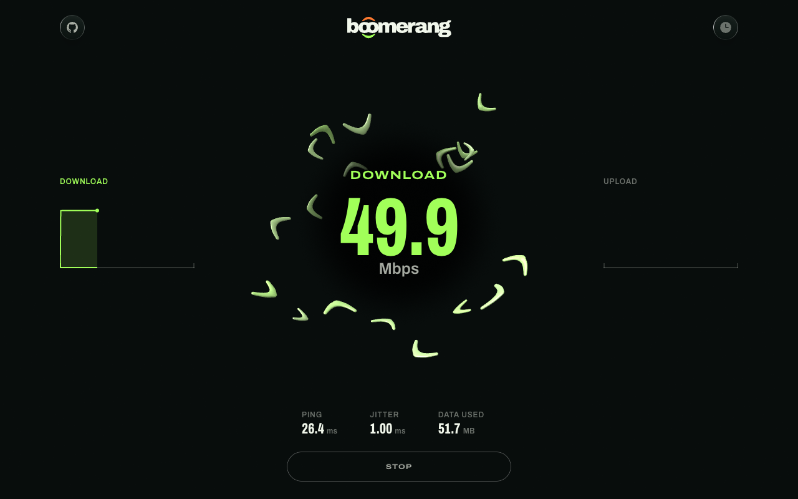
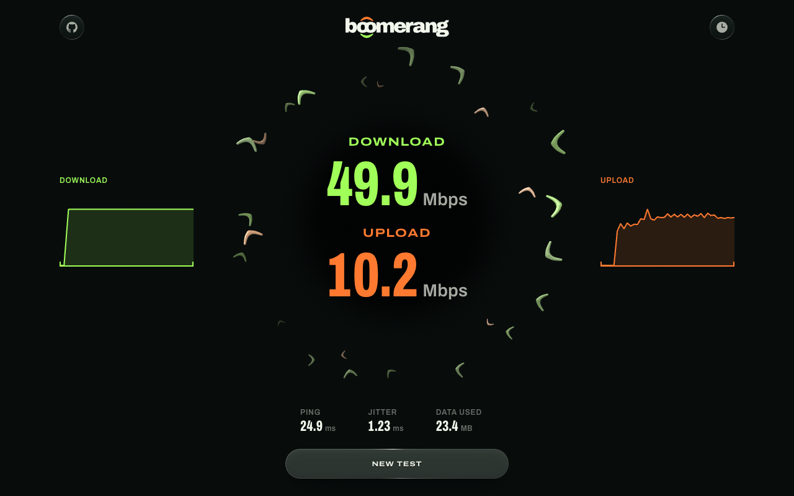
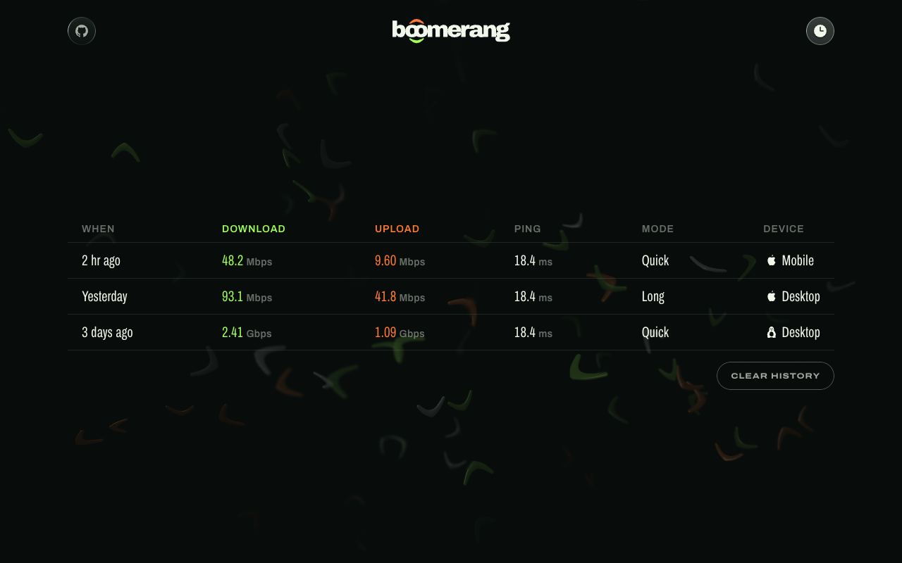
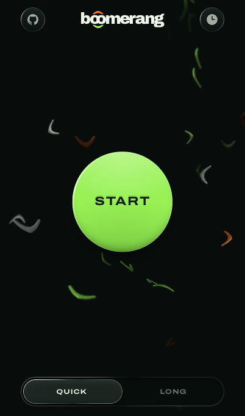
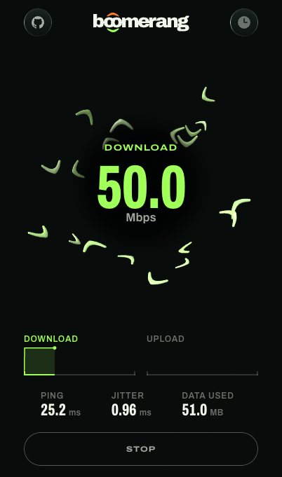
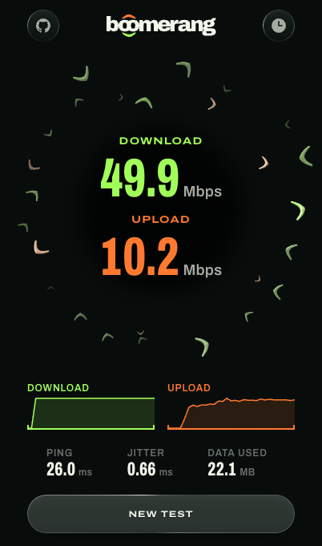
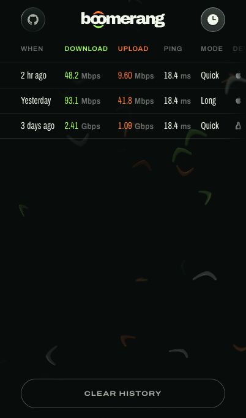

# Boomerang

A self-hosted speed test for your own network. Run it on a box at home, open
it on a phone or a laptop, and it measures the link between the two: your
Wi-Fi, your LAN or your tailnet, not your internet connection.

<p align="center">
  ⚡ <strong>Live demo <a href="https://boomerang.fernando.is">https://boomerang.fernando.is</a></strong><br/>
  <em>(a simulated run, it doesn't measure your connection)</em>
</p>

<table>
  <tr>
    <td width="50%"></td>
    <td width="50%"></td>
  </tr>
  <tr>
    <td align="center">Start</td>
    <td align="center">A run</td>
  </tr>
  <tr>
    <td width="50%"></td>
    <td width="50%"></td>
  </tr>
  <tr>
    <td align="center">A result</td>
    <td align="center">History</td>
  </tr>
</table>

<table>
  <tr>
    <td width="25%"></td>
    <td width="25%"></td>
    <td width="25%"></td>
    <td width="25%"></td>
  </tr>
  <tr>
    <td align="center">Start</td>
    <td align="center">A run</td>
    <td align="center">A result</td>
    <td align="center">History</td>
  </tr>
</table>

## Features

- **Download, upload, ping and jitter.** Ping is also probed during both
  transfers, so each run records latency under load as well.
- **Quick and Long runs.** Quick stops each direction once the rate settles,
  three to five seconds each way. Long runs thirty seconds each way.
- **History on the box.** Every run is saved on the server with its time,
  mode, results and device, so every browser that opens the box sees the same
  list. One setting keeps runs in each browser instead.
- **One small container.** One image holds the page, the test endpoints and
  the store for past runs.
- **No third-party requests.** The page loads nothing from another origin: no
  font service, no CDN, no analytics. The test suite fails on the first request
  that leaves the box.
- **Phone and desktop.** Each has its own layout, and both hold anything from
  under 1 Mbps to tens of Gbps.

## Quick start

On the box you want to test against, with Docker installed:

```sh
docker run -d --name boomerang --restart unless-stopped \
  -p 24610:3000 -v boomerang:/data \
  ghcr.io/fmaclen/boomerang
```

Then open `http://<the box's address>:24610` on another device on the same
network and press Start. Testing from the box itself only measures loopback.
Runs are kept in the `boomerang` volume, so they survive a restart or an
update. Add `-e HISTORY=browser` to keep them in each visitor's browser
instead.

That publishes the port on every interface the box has. The
[self-hosting guide](docs/self-hosting.md) covers binding it to one address,
running it with Docker Compose or behind a reverse proxy, keeping runs in the
browser instead, and updating to a new release.

## Contributing

Bug reports and ideas are welcome as issues. Read
[CONTRIBUTING.md](CONTRIBUTING.md) before you open one or send a change.
